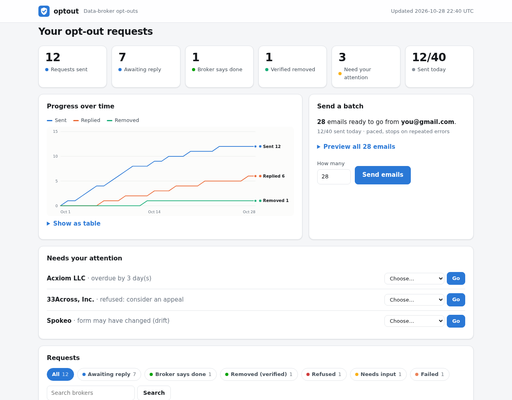

# optout

**Get your personal data deleted from data brokers, from your own computer.**

optout emails deletion requests to the ~580 data brokers registered with the State of
California, keeps track of who you contacted and when each legal deadline falls, and helps you
follow up with the ones that ignore you. It runs entirely on your machine: your details never
go to any server except the brokers you choose to email.

It's for one person: you. Each friend who wants to use it runs their own copy.



---

## Setup (about 5 minutes)

Tested on Linux and Windows (WSL); macOS should work the same way. You need a terminal and a Gmail account (other
providers work too, with one extra step).

**1. Install uv**, the tool that installs optout and the right Python for it:

```bash
curl -LsSf https://astral.sh/uv/install.sh | sh
```

Then close and reopen your terminal.

**2. Install optout:**

```bash
git clone https://github.com/Doaky/optout.git
cd optout
uv tool install --editable .
```

**3. Run it:**

```bash
optout
```

The first time, a short setup asks for:

| Step | What it asks | Notes |
|---|---|---|
| 1. About you | Name, address, date of birth; optionally old addresses, phone, relatives | Stays in a private file on your computer. Bulk emails only include your name, address, and email. |
| 2. Your email | Your email address, then an **app password** | Gmail and iCloud are detected and configured automatically: no server names to type. |
| 3. Broker list | Whether to download California's public broker list | Nothing is sent. |

Then your dashboard opens in your browser. From then on, `optout` just opens the dashboard.

### About the app password (Gmail)

Gmail won't let apps use your normal password. You create a separate 16-letter **app password**
just for optout. Setup links you straight to the right pages and checks it works before saving it:

1. Turn on 2-Step Verification: <https://myaccount.google.com/signinoptions/twosv>
2. Create an app password named `optout`: <https://myaccount.google.com/apppasswords>
3. Copy the 16 letters Google shows (like `abcd efgh ijkl mnop`) and paste them when asked.

If the app passwords page says it's unavailable, 2-Step Verification is off, or a work/school
administrator has disabled app passwords. Changed it later? Run `optout smtp-password`.

The password is stored in `~/.config/optout/smtp_password`, readable only by you.

---

## Using it

Everything happens on the dashboard (`optout`):

- **Send a batch.** Expand *Preview* to read every email exactly as it will be sent, then click
  **Send emails**. Up to 40 a day, a few seconds apart, so your account isn't flagged as a
  bulk mailer. About two weeks covers every broker.
- **Track requests.** Each broker has one row with a status, when you sent it, and how long
  until its legal deadline.
- **When a broker replies**, use the row's menu: *They say it's deleted*, *They refused*,
  *They need more info*, or *Automated reply only*.
- **Follow up** from the same menu: it writes a clarification, follow-up, appeal, or Attorney
  General complaint draft for you to copy into an email. Overdue requests show up under
  *Needs your attention*.

Other commands, if you prefer a terminal:

| Command | Does |
|---|---|
| `optout status` / `optout history` | Who you contacted, when, and what happened |
| `optout campaign --send` | Send a batch from the terminal |
| `optout log <company>` | Record a request you made yourself (e.g. a spammer) |
| `optout reply <broker> deleted` | Record a broker's answer |
| `optout escalate` | Write drafts for overdue or refused requests |
| `optout label` | Add your Gmail label to past sent emails and replies |
| `optout init` | Redo setup |

### Settings worth knowing

Your settings live in `~/.config/optout/config.yml`. Defaults are fine for most people:

```yaml
email:
  gmail_label: OPTOUT        # Gmail label put on sent requests (setup asks)
  daily_limit: 40            # emails per day
  send_delay_seconds: 5      # pause between emails
  alias_pattern: "optout-{slug}@yourdomain.com"   # optional: a different address per broker
```

With `alias_pattern` (needs your own domain with a catch-all), each broker gets its own
address, so spam to `optout-acme@…` tells you exactly who sold your data.

---

## What to expect (honestly)

- **Sent isn't deleted.** Many brokers reply with an automated message, ask for more
  information, or don't answer. The tool tracks deadlines so you know when to follow up.
- **"Broker says done" is their word.** Only people-search sites the tool can re-check
  reach "Removed (verified)".
- **The legal footing depends on your state.** Emails cite your state's privacy law for
  Virginia, California, Colorado, Connecticut, and Utah, and use general wording elsewhere.
  Only the Virginia citation has been checked against current statute text in this project.
  California residents should also use the state's free DROP (Delete Request and Opt-out
  Platform), which reaches every registered broker at once.
- **Some brokers are exempt.** Credit, finance, and health-regulated brokers are off by
  default because state deletion laws usually exclude that data.
- **Data comes back.** Brokers re-acquire information. Re-running every few months
  (it skips anyone you contacted in the last 90 days) keeps it down.
- **It won't stop spam you already get** from breaches or lists you joined; it reduces how much
  your details are bought and sold.

## Privacy and safety

- Runs locally. No telemetry. Settings and the database are private to your user account.
- The dashboard only listens on `127.0.0.1` and needs the one-time link optout opens for you.
  It checks every request's origin, uses a strict Content-Security-Policy, and escapes all
  broker data.
- Nothing is sent without you clicking Send (or explicitly enabling unattended sending).
- A request is only marked removed after a later re-search shows the listing gone.
- It never asks for an SSN, ID, or payment details.

## For developers

```bash
uv sync --all-extras
uv run pytest            # tests (a few drive a real browser if Playwright's Chromium is installed)
uv run ruff check src tests && uv run mypy src/optout/
```

Advanced pieces not covered above: per-broker web-form automation for people-search sites
(`optout queue` / `optout submit`, needs `uv run playwright install chromium`),
`optout verify` (re-search to confirm removal), `optout daily` (cron entry point),
`optout drift-check` (detect broken broker forms), and a `Dockerfile` for an unattended
email-only lane (untested).

## License and credits

AGPL-3.0. Derived from [Blake104/OptOut](https://github.com/Blake104/OptOut); ideas from
[auto-identity-remove](https://github.com/stephenlthorn/auto-identity-remove) and
[Privotron](https://github.com/kevinl95/Privotron) (both MIT). See `NOTICE`.
