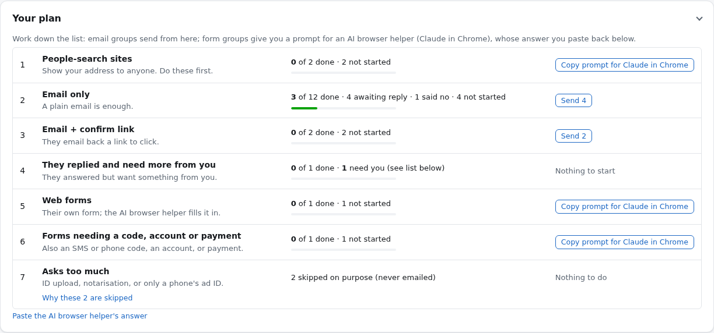
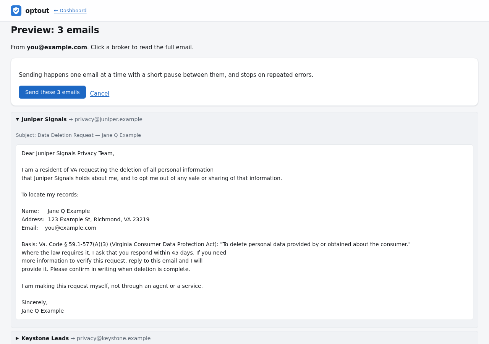
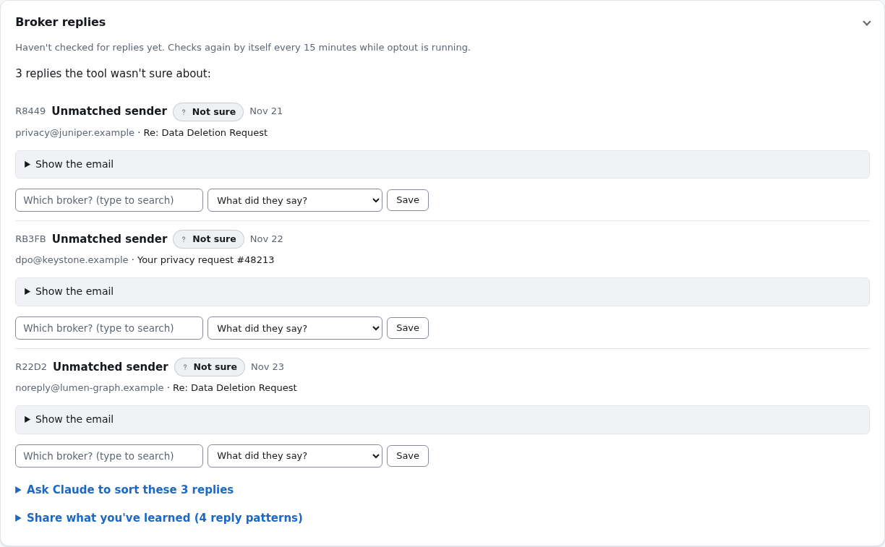
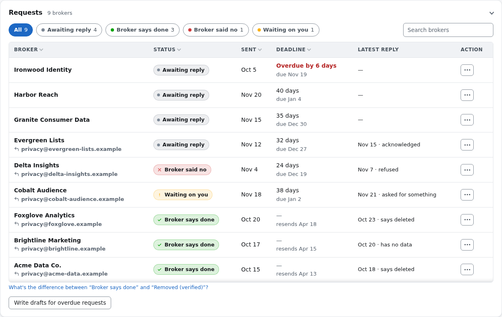
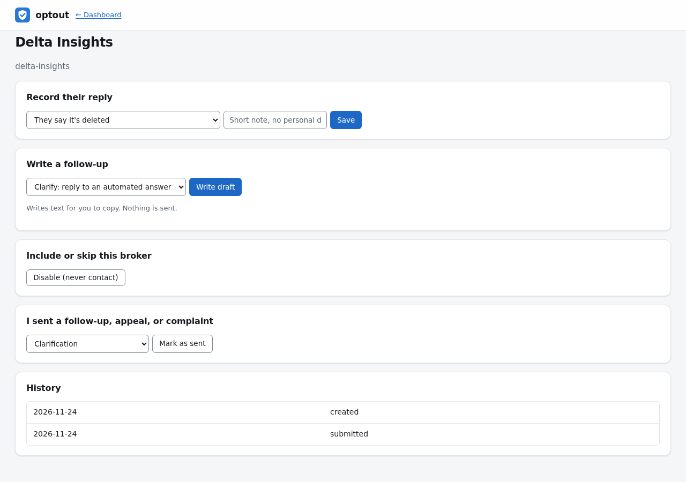
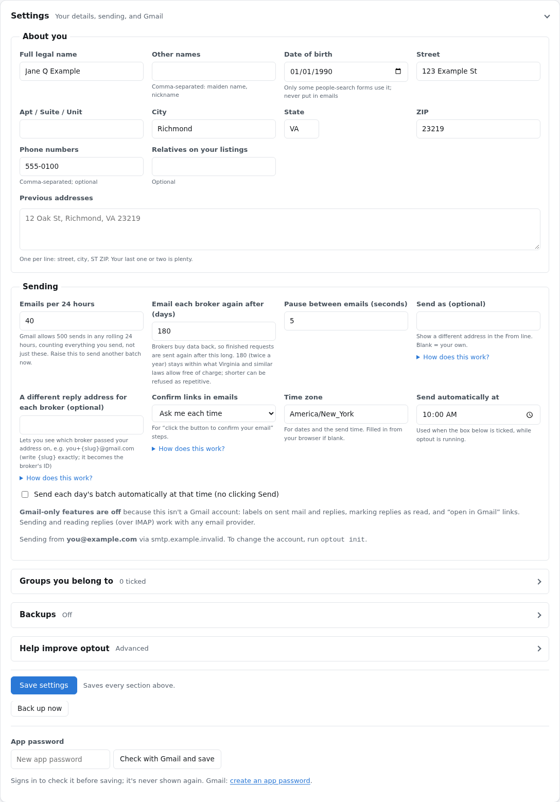

<p align="center">
  
</p>
<h1 align="center">optout</h1>
<p align="center">
  <b>Get your personal data deleted from data brokers, from your own computer.</b><br>
  A free, open-source, self-hosted alternative to paid data-removal services like DeleteMe,
  Incogni and Optery.
</p>
<p align="center">
  <a href="https://github.com/Doaky/optout/actions/workflows/ci.yml"></a>
  <a href="LICENSE"></a>
  
  
</p>

optout removes your personal information from data brokers and people-search sites. It
emails deletion requests to the ~600 data brokers registered with the State of
California (plus a few hundred more from public lists), reads their replies, keeps track of
each legal deadline, and helps you follow up with the ones that ignore you. It runs entirely
on your machine: your details never go to any server except the brokers you choose to email.

It's for one person: you. Each friend who wants to use it runs their own copy.

<picture>
  <source media="(prefers-color-scheme: dark)" srcset="docs/dashboard-dark.png">
  
</picture>

<sub>Sample data shown.</sub>

---

## Setup (about 5 minutes)

Tested on Linux and Windows (WSL); macOS should work the same way. You need a terminal and an email account
(Gmail gives you the most; see [Which email providers work](#which-email-providers-work)).

**1. Install uv**, the tool that installs optout and the right Python for it:

```bash
curl -LsSf https://astral.sh/uv/install.sh | sh
```

Then close and reopen your terminal.

**2. Install optout:**

```bash
git clone https://github.com/Doaky/optout.git
cd optout
uv tool install --editable . --with-executables-from playwright
```

This puts an `optout` command on your PATH (and `playwright`, used only for the optional
[form replay](#web-forms-and-people-search-sites)). uv fetches Python 3.12 or 3.13 if you
don't have it. If `optout` isn't found afterwards, run `uv tool update-shell` and reopen
the terminal.

<details><summary>Without uv</summary>

With Python 3.12 or 3.13 already installed: `python3 -m venv .venv && .venv/bin/pip install -e .`,
then run `.venv/bin/optout` (or activate the venv).
</details>

**3. Run it:**

```bash
optout
```

The first time, a short setup asks for:

| Step | What it asks | Notes |
|---|---|---|
| 1. About you | Name, address, date of birth; optionally old addresses, phone, relatives | Stays in a private file on your computer. Emails only include your name, address, and email. |
| 2. Your email | Your email address, then an **app password** | Gmail and iCloud are detected and configured automatically. It signs in to check the password (nothing is sent). |
| 3. Broker list | Whether to download California's public broker list | Nothing is sent. |

Then the dashboard opens in your browser. It's served by the `optout` process in your
terminal: leave that terminal open while you use it, and press Ctrl+C to stop. Next time,
just run `optout` again. If the browser doesn't open, copy the link it prints (it holds a
one-time key, so the plain address won't work). `optout ui --no-open` only prints the link.

Nothing is sent until you click **Send**.

### Which email providers work

| | Gmail / Google Workspace | iCloud, Outlook, Yahoo, others |
|---|---|---|
| Sending requests (SMTP + app password) | Yes | Yes |
| Plan, dashboard, forms, drafts, follow-ups | Yes | Yes |
| Reading and sorting broker replies automatically | Yes | Yes, over IMAP (see below) |
| Labels on sent mail and replies (`gmail_label`) | Yes | No (Gmail-only feature) |
| Marking recognised replies as read | Yes | No (Gmail-only feature) |
| "Open this email in Gmail" links | Yes | No |

Without Gmail, the tool reads your **Inbox** over plain IMAP, read-only: it looks for mail since your
first request that has the request's subject, comes from an address a broker has answered from, or is
a bounce. Nothing is marked read, moved or labelled. The IMAP server is worked out from your SMTP
server (`smtp.example.com` becomes `imap.example.com`; iCloud, Outlook and Yahoo are known). If yours
differs, set `imap_host:` under `email:` in your config. Replies that land in Spam or another
folder aren't seen, so check those by hand. The Gmail-only settings are hidden when your account
isn't Gmail.

### About the app password (Gmail)

Gmail won't let apps use your normal password. You create a separate 16-letter **app password**
just for optout. Setup links you straight to the right pages and checks it works before saving it:

1. Turn on 2-Step Verification: <https://myaccount.google.com/signinoptions/twosv>
2. Create an app password named `optout`: <https://myaccount.google.com/apppasswords>
3. Copy the 16 letters Google shows (like `abcd efgh ijkl mnop`) and paste them when asked.

If the app passwords page says it's unavailable, 2-Step Verification is off, or a work/school
administrator has disabled app passwords. iCloud works the same way: create an app-specific
password at <https://account.apple.com> (Sign-In and Security). Changed it later? Run
`optout smtp-password`, or use *Settings → App password* on the dashboard.

The same password is used to send (SMTP) and to read replies (IMAP). It is stored in
`~/.config/optout/smtp_password`, readable only by you, never in the config file.

---

## Your first week

Everything below happens on the dashboard. Each step also has a [terminal command](#terminal-commands).

### 1. Look at your plan

**Your plan** groups every broker by what it takes, in the order worth doing them. Work down
the list.



1. **People-search sites**: they show your address to anyone. Their own forms, done with an
   AI browser helper (see [Web forms](#web-forms-and-people-search-sites)).
2. **Email only**: a plain email is enough. One click sends a batch.
3. **Email + confirm link**: an email, then they send a link to click (clicked for you when
   *Confirm links* is set to automatic).
4. **They replied and need more from you**: answered, but want something (often their form).
5. **Web forms**: brokers that only act on their own form. Learned from their replies
   ("we don't accept email, use our portal"), so brokers move here as they answer.
6. **Forms needing a code, account or payment**: a form plus something only you can do.
7. **Asks too much**: skipped (see [below](#brokers-that-ask-too-much)).

California residents: the plan points you to the state's free
[DROP](https://consumer.drop.privacy.ca.gov/) portal first, which reaches every registered broker at once.

### 2. Send a batch of emails

Under **Send today's emails**, expand *Preview* to read every email exactly as it will be
sent, then click **Send emails**. Up to 40 a day (change it in Settings), a few seconds apart,
so your account isn't flagged as a bulk mailer. It stops by itself on repeated errors. Come
back each day for the next batch; a couple of weeks covers every broker.



Emails cite your state's privacy law where this project has checked it (see
[What to expect](#what-to-expect-honestly)).

### 3. Let it read the replies

Replies are read and sorted for you: a few minutes after a batch, every 15 minutes while the
dashboard is open, and whenever you click **Check for replies** at the top. Clear answers
("deleted", "we have no data", "use our form") update the request on their own. The ones
it isn't sure about wait under **Broker replies**: open the email, pick *What did they say?*,
or use *Ask Claude to sort these* to copy a prompt for Claude and paste its answer back.



### 4. Clear "Needs you"

**Needs you** at the top of the dashboard is your to-do list: brokers that asked for
something (usually their own form; the link is there), said no, or missed their legal
deadline. Each row has the buttons for what to do next: *I did what they asked*,
*Write appeal draft*, *Write follow-up draft*, or *Close: doesn't apply to me*.
**Send N follow-up emails** asks first, then emails every overdue broker a short reminder
in one go. Appeals and Attorney General complaints are
written as drafts for you to copy; they're never sent for you.

### 5. Keep an eye on the rest

**Requests** lists one row per broker with its status, when you sent it, and how long until
its deadline. Filter by status, search, or use a row's **⋯** menu to write a reminder, send
again, set the status by hand, or stop contacting that broker.



Click a broker's name for its own page: record a reply you got some other way, write a
follow-up, appeal or complaint draft, and see its full history.



### Web forms and people-search sites

Some brokers ignore email and only act on their own web form. optout doesn't fill these
blindly; it hands them to an AI browser helper such as Claude in Chrome, which you watch:

1. In **Your plan**, click **Copy prompt for Claude in Chrome** on a form group (up to 10
   forms at a time). The prompt holds the form links and the details each form needs.
2. Paste it into the helper in your own browser. Solve any CAPTCHA or SMS code it asks for.
3. It ends with a JSON answer. Paste that under **Paste the AI browser helper's answer**.
   Each broker is recorded as done or submitted, and the steps it used are saved.

Next time, `optout forms run` can replay saved steps in a browser window by itself (you
solve CAPTCHAs). That needs Google Chrome installed, or run `playwright install chromium`
and set `playwright: {channel: null}` in your config. Filled a form by hand? Click *I did what they asked*
under **Needs you**, or run `optout forms done <broker> submitted`.

### Settings

The gear at the top opens **Settings**: your details, the daily limit, how often to re-send,
a per-broker reply address, automatic confirm links, time zone, sending each day's batch
automatically, groups you belong to (to skip brokers that only cover, say, doctors or
real estate agents), encrypted backups, and your app password.



They're saved to `~/.config/optout/config.yml`. Every setting is described in
[`examples/config.example.yml`](examples/config.example.yml). Two worth knowing:

- `alias_pattern: "optout-{slug}@yourdomain.com"` (needs your own domain with a catch-all,
  or Gmail's `you+{slug}@gmail.com`): each broker gets its own reply address, so spam to
  `optout-acme@…` tells you exactly who sold your data.
- `allow_unattended: true` with a `daily_send_time`: sends each day's batch, and follow-ups
  to overdue brokers, without you clicking Send, while `optout` is running.

---

## Terminal commands

Everything on the dashboard also works from the terminal. `optout --help` lists all
commands; add `--help` to any of them for its options. Sending commands only preview
unless you add `--send`.

| Command | Does |
|---|---|
| `optout` / `optout ui` | Open the dashboard (first run: setup) |
| `optout plan` | Your plan, with progress per group |
| `optout campaign` / `optout campaign --send` | Preview / send today's batch (`--group email`, `--limit 10`) |
| `optout inbox` | Read broker replies now and apply the clear ones |
| `optout review` | Replies it wasn't sure about (`--prompt` / `--apply` for Claude) |
| `optout followups --send` | Re-email every broker past its deadline with no answer |
| `optout forms prompt` / `optout forms apply` | Web forms: prompt for your AI browser helper, then apply its answer |
| `optout status` / `optout history` | Who you contacted, when, and what happened |
| `optout reply <broker> deleted` | Record a broker's answer (`denied`, `need-info`, `auto-reply`) |
| `optout log <company>` | Record a request you made yourself, so its deadline is tracked |
| `optout escalate` | Write follow-up, appeal or complaint drafts (never sends) |
| `optout brokers list` / `optout brokers disable <broker>` | Browse brokers; never contact one |
| `optout brokers import` | Refresh California's broker list |
| `optout label` | Gmail: add your label to past sent emails and replies |
| `optout report` | Write a static HTML status page (no personal details) |
| `optout init` / `optout smtp-password` / `optout doctor` | Redo setup / replace the app password / check your setup |

Broker names in commands are the IDs shown by `optout brokers list` (e.g. `spokeo`).

## Brokers that ask too much

Some brokers are off by default because opting out would mean handing over more than they
have: a photo of your face or an ID (Clearview AI, PimEyes, FaceCheck.ID), or only your
phone's advertising ID or a browser cookie, not your name (Blis, Kargo, Madhive, OpenX and
others). The full list, with the reason for each, is under *Why these are skipped* in
**Your plan**. You can still turn one on from its page if you decide it's worth it.

For the advertising-ID ones, the better move is on your phone: reset its advertising ID and turn
on *Limit ad tracking* (iOS: Settings → Privacy → Tracking; Android: Settings → Privacy → Ads).

---

## Your data, backups and updates

| What | Where |
|---|---|
| Settings and profile | `~/.config/optout/config.yml` |
| App password | `~/.config/optout/smtp_password` |
| History (requests, replies, deadlines), drafts, broker list | `~/.local/share/optout/` |

All are readable only by you. The history only exists on this computer, so turn on
**Settings → Backups**: pick a folder (a synced folder is fine) and it writes an encrypted
copy every week. Or by hand: `OPTOUT_STATE_KEY='a passphrase' optout state export backup.enc`,
and `optout state import backup.enc` (same key) to restore. Backups and exports need `openssl`.

**Updating:** `cd optout && git pull`. If the update changed dependencies, run the install
command from step 2 again with `--force`. **Uninstalling:** `uv tool uninstall optout`, then
delete the two folders above.

## Running it on a schedule

Three options, from simplest:

- **On your computer, while it's running:** tick *Send each day's batch automatically* in
  Settings. Needs `optout` left running.
- **cron / Task Scheduler:** run `optout daily` once a day. With `allow_unattended: true` it
  sends the day's batch and follow-ups; it always reads replies and writes escalation drafts.
  Set `notify.webhook_url` (e.g. an [ntfy](https://ntfy.sh) topic) to get a summary.
- **GitHub Actions**, below. (There is also a `Dockerfile` / `docker-compose.yml` for an
  email-only container running `optout daily`; it's untested.)

### Run it on a schedule with GitHub Actions

`.github/workflows/scheduled.yml` runs `optout daily` once a month (send the next batch,
read replies, draft follow-ups) and refreshes California's broker list. It's off until you
turn it on, and it only runs in a **private** repository.

1. Make a private copy of this repo (GitHub: *Import repository*, or push a clone to a new
   private repo) and `cd` into your clone of it.
2. Pick a long passphrase and save your history to it, so nobody gets emailed twice:
   ```
   export OPTOUT_STATE_KEY='a long passphrase you keep somewhere safe'
   optout state push        # encrypts your history onto the optout-state branch of origin
   ```
   Run this inside that clone: it pushes to its `origin` remote (`--remote` to change).
   Needs `git` and `openssl`.
3. Set `email.allow_unattended: true` in your config, then add repository **secrets**:
   `OPTOUT_STATE_KEY` (the same passphrase), `OPTOUT_SMTP_PASSWORD` (your app password),
   and `OPTOUT_CONFIG_B64` (`base64 -w0 ~/.config/optout/config.yml`; on macOS `base64 -i`).
4. Add the repository **variable** `OPTOUT_SCHEDULE` = `on`. Run it once from the Actions tab
   to check.

The workflow restores your history, runs, and saves it back. Before using the dashboard on
your computer, `optout state pull` to see what it did, and `optout state push` afterwards, so
both sides stay in step. The history is encrypted (AES-256, never your profile or password),
and the branch keeps only the latest copy. Change the `cron:` line for weekly runs.

---

## What to expect (honestly)

- **Sent isn't deleted.** Many brokers reply with an automated message, ask for more
  information, or don't answer. The tool tracks deadlines so you know when to follow up.
- **"Broker says done" is their word.** Only people-search sites the tool can re-check
  reach "Removed (verified)".
- **The legal footing depends on your state.** Emails cite your state's privacy law where
  the citation has been checked against official text in this project (`optout statutes list`
  shows which: currently Virginia, Texas, Oregon, Montana, Delaware, New Hampshire, Minnesota,
  Nebraska, Rhode Island and New Jersey), and use general wording elsewhere.
  California residents should also use the state's free DROP (Delete Request and Opt-out
  Platform), which reaches every registered broker at once. [COMPLIANCE.md](COMPLIANCE.md)
  lists each law's citation, deadlines and official source.
- **Some brokers are exempt.** Credit, finance, and health-regulated brokers are off by
  default because state deletion laws usually exclude that data.
- **Data comes back.** Brokers re-acquire information. Each broker is emailed again
  180 days after its last request finished (`resend_after_days`), which keeps it down.
- **It won't stop spam you already get** from breaches or lists you joined; it reduces how much
  your details are bought and sold.

## Privacy and safety

- Runs locally. No telemetry. Settings and the database are private to your user account.
- The dashboard only listens on `127.0.0.1` and needs the one-time link optout opens for you.
  It checks every request's origin, uses a strict Content-Security-Policy, and escapes all
  broker data.
- Nothing is sent without you clicking Send (or explicitly enabling unattended sending).
- Reply emails are read as text only. Links in them are never opened, except "confirm your
  request" links from known broker senders, and only when you allow it.
- A request is only marked removed after a later re-search shows the listing gone.
- It never asks for an SSN, ID, or payment details.

## FAQ

**How do I remove my personal information from data brokers?**
Each broker has to be asked separately, and most take weeks to answer. optout does the
asking for you: it emails each one a deletion request under your state's privacy law,
reads the replies, and tells you which ones still need something from you. See
[Setup](#setup-about-5-minutes) and [Your first week](#your-first-week).

**Is this a free alternative to DeleteMe, Incogni or Optery?**
Yes, with one difference: you run it yourself. The requests come from your own email
address and your details stay on your computer, but there's no team doing the
web-form-only brokers for you. optout prepares those, and an AI browser helper can fill
them in.

**Which laws does it cite?**
Your state's consumer privacy law, quoted word for word from the official text, for
the states listed in [COMPLIANCE.md](COMPLIANCE.md). Everywhere else, the emails use
general wording. California residents should also use the state's free DROP portal.

**Does it send my data anywhere?**
Only to the brokers you choose to email, from your own account. See
[Privacy and safety](#privacy-and-safety).

**Do I need Gmail?**
No. Any provider with SMTP and IMAP works; Gmail adds labels and one-click links. See
[Which email providers work](#which-email-providers-work).

## For developers

```bash
uv sync --all-extras
uv run pytest            # tests (a few drive a real browser if Playwright's Chromium is installed)
uv run ruff check src tests && uv run mypy src/optout/
```

To try the app without touching your own data, point it at empty folders:
`XDG_CONFIG_HOME=/tmp/o/cfg XDG_DATA_HOME=/tmp/o/data uv run optout`.

Advanced pieces not covered above: per-broker web-form automation for a few people-search
sites (`optout queue` / `optout submit`), `optout scan` and `optout verify` (search for your
listings; re-search to confirm removal), `optout brokers probe` and `optout drift-check`
(check broker forms still match), and `optout replies share` / `optout forms share` (print what
you've taught the tool, to contribute). See [CONTRIBUTING.md](CONTRIBUTING.md).

## License and credits

AGPL-3.0. optout started from [Blake104/OptOut](https://github.com/Blake104/OptOut) and
has since been largely rewritten; thanks to its authors for the starting point. Ideas from
[auto-identity-remove](https://github.com/stephenlthorn/auto-identity-remove) and
[Privotron](https://github.com/kevinl95/Privotron) (both MIT). Extra brokers and form
links from [Eraser](https://github.com/digisamroc/eraser) (MIT); people-search priorities
checked against [BADBOOL](https://github.com/yaelwrites/Big-Ass-Data-Broker-Opt-Out-List).
See `NOTICE`.
